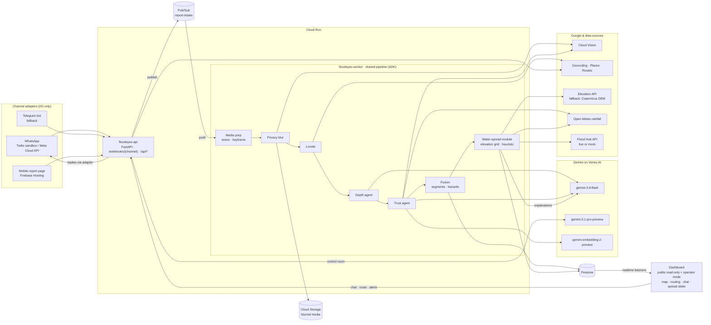

# Flood Eyes: Build Plan (v2)

> **"Flood Hub forecasts the flood. Flood Eyes measures it."**
> Google Cloud AI Builder Cup 2026 · Theme: Sustainability & Social Impact
> Plan date: Fri Oct 2, 2026 · Target submission: **Sat Oct 17** · Official deadline: Sun Oct 18
> Status: **v2 DRAFT, awaiting approval. No application code until approved.**

**What changed in v2 (summary):** we now have three thin front ends: a WhatsApp-first bot with a Telegram fallback behind a channel interface, a mobile web reporting page, and a dashboard with a public read-only view. They all share one Cloud Run backend. The native Android app moves to the roadmap. **Water-spread prediction** is a new phase-2 headline feature (days 9–11) with its own cut point. Video clips are optional. Rescue triage, voice line, Android app, and WhatsApp production rollout are roadmap only. The schedule, risks, cut list, and video script are revised, and a compliance checklist is added (§8.1). Project memory is in `CLAUDE.md`.

---

## 0. Things to act on today (before anything else)

| # | Item | Why it matters |
|---|------|----------------|
| 1 | **Register the team by Sun Oct 4.** Public listings give **Oct 4, 2026** as the last registration date. | If we miss it, we can't submit. |
| 2 | **Confirm a second team member.** The rules say teams of **2–4**. Members must be working professionals aged 21+ (no students). | This is an eligibility rule. |
| 3 | Create the GCP project, billing or credits, and enable the APIs (§3.10). | Some enablements and quota changes take hours. |
| 4 | Join the **Flood Forecasting API waitlist**. | Approval may take months, so we plan around a mock (R3). |
| 5 | Create a **Twilio account** (WhatsApp sandbox) and a **Meta developer app** (WhatsApp Cloud API). | Account verification steps can take time, so start them before the WhatsApp day. |

---

## 1. Understanding, concerns, and improvements

### 1.1 Understanding
Flood Eyes turns citizen flood photos into **street-level depth measurements during the event**. Gemini reads known-height objects in each photo (wheels, kerbs, knees, scooter seats) and estimates a depth band plus passability for each vehicle class. A trust layer removes recycled, fake, and duplicate photos. Reports are fused into a live, time-decaying map, and ambulance routes are steered around impassable points. **A prediction layer shows where the water is likely to spread in the next 30–60 minutes.** A Gemini control room answers questions and writes multilingual alerts. All of this complements Google Flood Hub's 24-hour urban flash-flood forecasts by supplying the ground truth Google has said is missing.

### 1.2 Verified facts that shape the plan (checked Oct 2, 2026)

| Topic | Finding | Effect on the plan |
|---|---|---|
| **Gemini models** | Stable: `gemini-3.8-flash`, `gemini-3.7-flash`, `gemini-3.5-flash`, `gemini-3.5-flash-lite`. The Pro tier is only **`gemini-3.1-pro-preview`**. 2.0 Flash has been shut down. | Per-photo work uses `gemini-3.8-flash`. The control room uses `gemini-3.1-pro-preview`, with fallback to Flash. Model IDs live only in config. |
| **Embeddings** | `gemini-embedding-2-preview` is multimodal and accepts images. | Used for semantic near-duplicate detection, alongside a perceptual hash (pHash). |
| **ADK** | `google-adk` Python v2.6.0 (Jul 29, 2026), Python ≥3.10. | Pin the version on Day 1. |
| **Routes API** | It can't avoid arbitrary areas, only tolls, highways, ferries, and indoor routes, and those only bias results. | Filter or rank the alternatives, with a via-waypoint detour fallback (§3.7). |
| **Flood Forecasting API** | `flashFloods:search` returns flash-flood events with affected polygons. Access is by **waitlist**. | `FloodForecastProvider` interface, live or mock. |
| **WhatsApp: Meta Cloud API test number** | Free, no payment method needed, but it can message **only 5 pre-registered recipients**. Webhook needs GET verification and a signature header. Media download URLs **expire after 5 minutes**. The default access token is short-lived, so a system-user token is needed. | **Judges can't use it**, because their numbers aren't registered. Good as the "production path" design. |
| **WhatsApp: Twilio sandbox** | Anyone can join by texting `join <code>`. Sessions **expire 3 days after joining**. Sends are limited to **1 message every 3 seconds**. Free-form replies only within 24 hours of the user's last message. Media URLs are Twilio-hosted. | **Faster to set up and judges can join**, so this is the **primary WhatsApp option**. The 3-day expiry and rate limit are fine for a demo. |
| **Telegram** | Photos sent as "photo" have their EXIF stripped. The bot is open to anyone. | Fallback adapter. The bot asks for location sharing. |
| **Google Elevation API** | Up to 512 locations per request. Path sampling is supported. Each result includes a `resolution` value in metres. | **Primary elevation source** (Google-native, simple). Caching follows Maps Platform terms; see R13. |
| **Open DEMs** | Copernicus GLO-30 (30 m) has the best vertical accuracy of the free global DEMs. It's a surface model, so it includes buildings, and **cities are noisy**. FABDEM removes buildings but has a **non-commercial licence**. | **Fallback only:** a Copernicus GLO-30 tile clipped per city and stored in Cloud Storage, if the Elevation API is unsuitable. |
| **Gemini video input** | Inline video under 100 MB is supported. Default sampling is 1 frame per second, with a configurable `fps` and `media_resolution`. | For 5–10 s clips: downscale to 720p and sample at ~3–5 fps so the model can see water movement. |

### 1.3 Score-raising decisions (kept from v1, plus new ones)
1. **The model shows its work.** Gemini returns boxes around the reference objects and the waterline, and the dashboard draws them over the blurred photo.
2. **Several reference objects check each other** for a self-calibrated confidence score. The model **abstains** (`insufficient_evidence`) when it can't tell.
3. **Headline safety metric: false-safe rate**, meaning impassable water that was labelled passable.
4. **Agents for judgment, plain code for math.** Depth and trust use LLM agents. Fusion, routing, and spread are deterministic tools. The control room is the agent that orchestrates them.
5. **Reverse-image search** (Cloud Vision Web Detection) for recycled photos, plus a check for AI-generated images.
6. **Water-spread prediction (new):** terrain-aware "where next", explained by Gemini in plain language, shown as an animated time slider. It turns the product from a record of what happened into an early warning, and it's the closing shot of the video.
7. **Channel-agnostic intake (new):** WhatsApp, Telegram, and web are interchangeable adapters. That supports the scalability story and lets us reach users where they already are.
8. **Public read-only dashboard (new):** opens instantly for judges, seeded so it's never empty.
9. **Standards:** GeoJSON export of validated observations (the feedback loop to Flood Hub) and CAP-shaped alerts.

### 1.4 Concerns about the new decisions
- **WhatsApp reachability for judges.** Joining the Twilio sandbox takes one step: text `join <code>` to a number. We'll put a QR code and instructions in the submission notes. **The web reporting page is the zero-friction path for judges**, so it must be solid. The dashboard is what they'll actually click.
- **Replying within a few seconds.** The full pipeline (blur, Gemini, trust) takes about 4–8 s. The bot sends an instant "Got it, analysing…" and then the result when it's ready (still well within WhatsApp's 24-hour reply window). Twilio sandbox throughput (1 message every 3 s) means the **replay demo doesn't send WhatsApp replies**; replay goes through the web intake path.
- **Elevation is weak in flat cities.** Mumbai and Chennai have only a few metres of relief. Water-spread prediction should therefore be shown with confidence levels and presented as "likely next", never as certainty. **Bengaluru (hilly, with known low-lying underpasses) is the strongest demo city for this feature.**
- **Video privacy.** Blurring every frame of a video is expensive. Instead, **we never store videos**: we analyse them in memory and keep only one blurred keyframe.

### 1.5 Compliance check of this plan (against `CLAUDE.md` rules)
| Rule | Status |
|---|---|
| All core intelligence on Gemini / ADK | ✅ Depth, trust, response, control room, spread explanations, and video analysis all use Gemini. Other ML used is also Google's: Cloud Vision for blurring and web detection. pHash and the spread heuristic are deterministic code, not models. |
| Backend on Cloud Run, front ends on Firebase Hosting | ✅ |
| Third parties only as I/O or data (Twilio, Meta, Telegram, Open-Meteo, Copernicus DEM) | ✅ No third-party service makes a decision. |
| English-only code, docs, and deck; captions for multilingual output in the video | ✅ Added to the video plan (§8.4). |
| Public no-login read-only view, seeded | ✅ §3.8, plus a seed script. |
| Submission package and date | ✅ §8. |

---

## 2. Clarifying questions (still open)

1. **Who is the teammate, and what are their skills?** The parallel tracks assume Dev B covers the frontend, channels, and infra.
2. Do you have GCP billing or credits? [Assumed: personal account with a $50 budget alert.]
3. Is Bengaluru OK as the demo city? [Assumed: yes. It's now also the best city for water-spread prediction.]
4. Do you have flood photos and videos you own or can use with permission?
5. Is Vertex AI auth on Cloud Run OK, with AI Studio keys only for local eval? [Assumed: yes.]
6. Do you have native speakers to spot-check Hindi, Kannada, and Tamil alerts?
7. Is a clearly labelled scripted replay acceptable in the video, alongside one live WhatsApp report? [Assumed: yes.]
8. **New:** for the operator mode (sending alerts and approving drafts), is a simple passcode-gated toggle enough for the demo? [Assumed: yes. Firebase Auth comes later.]

---

## 3. Final architecture

### 3.1 Components

| Component | Tech | Responsibility |
|---|---|---|
| **Channel adapters** | `WhatsAppTwilioAdapter` (primary), `WhatsAppMetaAdapter` (production path, optional), `TelegramAdapter` (fallback), `WebAdapter` | Normalise inbound messages; fetch media; send replies |
| **API service** | FastAPI on Cloud Run (`floodeyes-api`) | `/webhooks/{channel}`, `/api/reports`, dashboard REST, routing, chat, alerts, spread |
| **Worker** | Cloud Run (`floodeyes-worker`), receives Pub/Sub push | Report pipeline: media prep → blur → locate → depth → trust → fuse → reply |
| **Spread service** | Runs inside the worker, triggered on segment changes and every 5 min while an event is active | Elevation grid → spread heuristic → Gemini explanations → `predictions` |
| **Agents** | ADK `google-adk` + `google-genai` on Vertex | Depth, Trust, Response, SpreadExplainer, ControlRoom, and the `ReportPipeline` workflow |
| **Storage** | Cloud Storage | Blurred images and keyframes only. Raw media deleted after processing (24-hour lifecycle as a safety net). |
| **Database** | Firestore | Reports, segments, hazards, predictions, alerts, POIs, conversations, cities |
| **Mobile report page** | Firebase Hosting, **separate lightweight entry point** (vanilla TS) | Camera capture, on-device compression, geolocation, caption, upload retry |
| **Dashboard** | React + Vite + Maps JS (`@vis.gl/react-google-maps`) on Firebase Hosting | Public read-only view, plus an operator mode for chat actions and alert sending |
| **External** | Geocoding, Routes, Places, **Elevation**, Cloud Vision, Open-Meteo, Flood Forecasting (live or mock) | Context and enrichment |
| **Ops** | Secret Manager, `deploy.sh` / Cloud Build, Logging and Trace, budget alerts | — |

### 3.2 Messaging-channel interface

```python
class InboundMessage(BaseModel):
    channel: Literal["whatsapp_twilio", "whatsapp_meta", "telegram", "web"]
    idempotency_key: str            # provider message id
    sender_hash: str                # salted SHA-256 of provider user id
    reply_ref: str | None           # encrypted address for replies (never logged)
    text: str | None
    media: list[MediaRef]           # {kind: image|video, provider_ref, mime}
    location: LatLng | None
    received_at: datetime

class MessagingChannel(Protocol):
    name: str
    async def verify(self, request: Request) -> bool          # signature / token check
    async def parse(self, request: Request) -> list[InboundMessage]
    async def fetch_media(self, ref: MediaRef) -> bytes       # Meta: URL expires in 5 min → fetch immediately
    async def send_text(self, reply_ref: str, text: str) -> None
    async def request_location(self, reply_ref: str) -> None  # channel-native prompt where available
```
The core pipeline only ever sees `InboundMessage` and calls `channel.send_text`. **Adding a channel means writing one file and one route.** Conversation state (for example, "waiting for location") lives in `conversations/{sender_hash}`, so the bot asks for location only once.

**Bot flow:**
1. A photo or video arrives, with an optional caption or location.
2. The bot sends an instant acknowledgement: "Got it, analysing 📷".
3. If there's no location and none can be inferred, the bot asks once: "Please share your location (📎 → Location) or type the nearest landmark." The report is held until the user answers.
4. The result reply: "🌊 Estimated 30–60 cm (reference: car wheel). 🚗 Cars: avoid. 🛵 Two-wheelers: avoid. 🚌 Bus: OK with caution. Thank you, your report is helping others stay safe."

### 3.3 Data flow (one report)
1. **Intake (<1 s):** `verify` the request, then `parse` it. Deduplicate on `idempotency_key`. Fetch media immediately (Meta URLs expire after 5 minutes) into a temporary bucket. Write `reports/{id}` with `status=received`, publish to Pub/Sub, and acknowledge.
2. **Media prep:** for an image, resize to at most 1536 px. For a video, downscale to 720p with ffmpeg, keep the bytes in memory for Gemini, and extract the sharpest keyframe for display.
3. **Privacy:** Vision faces and license-plate detection, then a Pillow blur on the image or keyframe. Write the blurred version to Cloud Storage and delete the raw file.
4. **Locate:** use the first that works: channel location, then EXIF (web), then browser geolocation, then Gemini caption-landmark extraction with Geocoding. Otherwise use the conversation flow to ask for it.
5. **Depth agent** (image or video) → `depth` block.
6. **Trust agent** → `trust` block.
7. **Fusion** → `segments`, `hazards`. A segment change emits a `spread.recompute` event, debounced to once a minute per city.
8. **Reply** via the originating adapter.
9. **Response triggers** (alert drafts) and **live dashboard updates** via Firestore listeners.

### 3.4 Architecture diagram



### 3.5 Agents and tools

**A. `DepthAgent`** (`gemini-3.8-flash`, temperature 0, JSON schema). Unchanged from v1: reference objects with `box_2d`, a waterline box, per-object estimates, a reconciled `depth_cm` range, `depth_band` (`lt15|15to30|30to60|gt60|insufficient_evidence`), `confidence`, `explanation`, `scene_notes`. Passability is **derived in code** from configurable thresholds. **Video variant (optional):** the same schema plus:
```json
"flow": {"speed": "still|slow|fast|unknown", "evidence": "debris moving ~1 m/s left to right",
         "pedestrian_safe": false},
"keyframe_ts_s": 3.2
```
A rule in code: if the water is **fast**, pedestrians and two-wheelers are unsafe at any depth, and car thresholds drop by one band.

**B. `TrustAgent`.** Unchanged: duplicates (pHash and embeddings), Vision web detection, EXIF, Open-Meteo rainfall consistency, agreement with neighbours, and a Gemini visual-consistency and AI-generation check, then a Flash adjudicator. Hard rules in code override the adjudicator.

**C. Fusion (code).** Geohash-7 segments. Each report is weighted by trust × confidence × time decay (τ = 45 min). The segment band is the weighted median. Hazards are computed per vehicle class.

**D. Water-spread module (code) + `SpreadExplainer` agent (Flash)**
- **Grid:** for each city, an elevation grid of geohash-7 cells (~150 m) is fetched lazily within 1.5 km of any flooded segment, in batches of ≤512 points per Elevation API call. It's cached in memory and Firestore for the event's duration, within the Maps terms; see R13.
- **Heuristic (deliberately simple, not hydrology):**
  1. *Water surface* at each flooded cell = ground elevation + fused depth.
  2. *Downhill flow:* from each flooded cell, follow the steepest-descent path through neighbouring cells (8 directions), marking cells along it.
  3. *Ponding:* neighbouring cells whose ground is **below** the water surface of a connected flooded cell are marked "likely to fill", starting with the lowest.
  4. *Horizon and score:* each candidate gets `score = f(elevation drop, distance, upstream flooded depth, rainfall)`. Rainfall is Open-Meteo's next-hour precipitation plus the last 3 hours. Above-threshold cells are bucketed as +30 or +60 min by distance and drop. If rainfall is below ~2 mm/h, horizons stretch and confidence falls.
  5. *Prior:* if a cell intersects a Flood Hub flash-flood polygon (live or mock), its score is boosted.
  6. Contiguous cells are merged into **predicted areas**, named by reverse geocoding and labelled with their roads.
- **`SpreadExplainer`** (Flash, JSON): given the structured facts for an area (drop, distance, direction, source segment, rainfall, Flood Hub overlap), it writes one sentence such as *"About 3 m lower than the flooded Silk Board junction 200 m north; likely to flood within 30–60 min if rain continues."* It's **not allowed to invent numbers**: the prompt passes the facts and the output is checked against them.
- **Routing integration:** predicted areas are a **soft penalty** in route ranking. They're shown as amber and never block a route on their own.
- **Snapshots:** each recompute writes `predictions/{cityId}_{ts}`, which is what the time slider plays back.

**E. `ResponseAgent`** (Flash). CAP-shaped alert drafts with translations. Sending needs operator mode, or the `AUTO_PUBLISH_ALERTS` flag for the demo. **New:** an alert can cover a *predicted* area ("may flood within the hour").

**F. `ControlRoomAgent`** (ADK `LlmAgent`, `gemini-3.1-pro-preview`, falls back to Flash). Tools: `get_flood_summary`, `list_hazards`, `find_pois`, `plan_safe_route`, `check_reachability`, `get_report`, `search_reports`, `get_forecast_context`, **`get_spread_prediction(area?, horizon_min)`**, and `draft_alert`. Example question: *"Which hospitals will an ambulance from Koramangala still reach in the next hour?"* The agent checks hazards, the predicted spread, and the routes.

### 3.6 Firestore data model

```
cities/{cityId}            name, bbox, center, timezone, languages[], decayTauMin,
                           passabilityThresholds, referenceHeights, spread{gridPrecision, radiusKm}
reports/{reportId}         cityId, channel, mediaKind: image|video, createdAt, capturedAt?, status,
                           reporterHash, caption, captionLang, location{lat,lng,geohash,method},
                           imagePath (blurred image or keyframe), pHash, depth{...}, flow{...}?,
                           passability{...}, trust{score,label,reasons[],signals{...}},
                           segmentKey, replayRunId?
conversations/{senderHash} channel, state: idle|awaiting_location, pendingReportId, lang, updatedAt
                           (TTL 24 h)
segments/{segmentKey}      cityId, center, name, band, depthCmMid, disagreement, weight,
                           reportCount, lastReportAt, staleness, passability, contributingReportIds[]
hazards/{segmentKey}       cityId, center, radiusM, blocked{two_wheeler,car,bus,ambulance}, updatedAt
elevation/{cityId_geohash7} elevationM, resolutionM, source: google|copernicus, fetchedAt  (event-scoped)
predictions/{cityId_ts}    cityId, createdAt, rainfallMmH, floodHubOverlap: bool,
                           areas[{id, geohashes[], centroid, name, roads[], horizonMin: 30|60,
                                  score, confidence, sourceSegmentKeys[], explanation}]
alerts/{alertId}           cityId, area, basis: observed|predicted, severity, status, cap{...},
                           translations{...}, createdBy, sentAt
pois/{poiId}               cityId, type, name, location, placeId
subscribers/{hash}         cityId, channel, replyRefEncrypted, lang, area, optInAt
replayRuns/{runId}         scenario, startedAt, speed, status
```
Security rules: anyone (unauthenticated) can **read** `reports` (public fields only), `segments`, `hazards`, `predictions`, and `alerts` with status `sent`. **All writes go through the API service account.** `conversations` and `subscribers` are never readable by clients.

### 3.7 Routing
`computeRoutes` with alternatives, then a Shapely check against the hazards for the vehicle class (~40 m buffer). The fastest clear route wins. **Predicted areas add a time penalty** to a route's ranking but don't block it. If every route is blocked, try via-waypoint detours (≤6 calls). If that fails, return "no safe route" with the least-bad option. Results are cached for 2 minutes per hazard version.

### 3.8 Dashboard modes
- **Public read-only (the default URL, no login):** live map, report details with box overlays, segments, the spread slider, the routing demo (rate-limited), and the control-room chat (rate-limited per IP, read-only tools only). Seeded from a **snapshot of the Bengaluru demo scenario**, so a fresh browser never sees an empty map. A banner reads: "Demo data: Bengaluru scenario replay · Live reports appear in real time".
- **Operator mode** (passcode toggle): approve and send alerts, trigger replay, and use the `draft_alert` tool.
- Laptop-first layout: map at ~70% width, with a right panel tabbed Reports / Route / Assistant / Alerts. The time slider is docked at the bottom.

### 3.9 Mobile report page (low-end phones, slow networks)
- A separate Vite entry built with **vanilla TypeScript**, not React. Target: **<50 KB JS gzipped, <100 KB total first load**, with system fonts.
- `<input type="file" accept="image/*" capture="environment">`, which uses the native camera and works on old Android browsers.
- **Compression on the device:** read EXIF first (tiny parser, so we keep time and GPS), then canvas-resize to ≤1280 px, JPEG quality ~0.7 (≈150–300 KB). Videos are optional and capped at 10 s / 15 MB.
- Geolocation with a timeout and a "type a landmark instead" fallback.
- Upload with a progress bar, **automatic retry with backoff**, and an IndexedDB queue so a failed upload survives a reload. Clear states throughout: *Compressing → Uploading 43% → Analysing → Result card*.
- Open from a link or QR code. The result card shows the depth band and passability.

### 3.10 GCP services to enable
Cloud Run, Cloud Build, Artifact Registry, Pub/Sub, Firestore, Cloud Storage, Secret Manager, Vertex AI, Cloud Vision, Maps JavaScript, Geocoding, Routes, Places (New), **Elevation**, Firebase Hosting. Budget alerts. Key restrictions: referrer-restricted keys for the browser, and server keys only in Secret Manager.

---

## 4. Repo structure

```
FloodEyes/
├── CLAUDE.md                     # project memory + compliance rules
├── PLAN.md
├── README.md
├── .env.example
├── docs/                         # architecture.md, prompts.md, deck/
├── backend/
│   ├── pyproject.toml            # uv; pinned google-adk, google-genai, fastapi
│   ├── Dockerfile                # includes ffmpeg (video, optional)
│   ├── app/
│   │   ├── main.py               # app factory: API mode / worker mode
│   │   ├── config.py             # settings, model IDs, city loader
│   │   ├── channels/             # base.py (Protocol + InboundMessage), whatsapp_twilio.py,
│   │   │                         # whatsapp_meta.py, telegram.py, web.py, conversation.py
│   │   ├── api/                  # webhooks.py, reports.py, routing.py, chat.py, alerts.py,
│   │   │                         # spread.py, worker.py
│   │   ├── agents/               # depth.py, trust.py, response.py, spread_explainer.py,
│   │   │                         # control_room.py, pipeline.py, prompts/
│   │   ├── services/             # vision_blur.py, media.py, geocode.py, routes.py, rain.py,
│   │   │                         # elevation.py, floodhub.py, storage.py, firestore.py
│   │   ├── fusion/               # segmenting.py, estimator.py, passability.py
│   │   ├── spread/               # grid.py, heuristic.py, areas.py
│   │   └── models/               # pydantic schemas
│   ├── cities/                   # blr.yaml, mum.yaml, mnl.yaml
│   └── tests/
├── web/
│   ├── dashboard/                # React + Vite + TS
│   └── report/                   # vanilla TS, lightweight mobile page
├── eval/                         # data/, labels/, run_depth_eval.py, run_trust_eval.py,
│                                 # run_spread_backtest.py, results/
├── scripts/                      # seed_pois.py, seed_demo_snapshot.py, replay.py,
│                                 # scenarios/blr_silkboard.yaml, deploy.sh, precheck.sh
└── infra/                        # cloudbuild.yaml, firestore.rules, firestore.indexes.json
```
(There's no `android/` folder; the app is on the roadmap.)

---

## 5. Day-by-day plan (Oct 2–17)

**Dev A** = you (AI/backend). **Dev B** = teammate (frontend, channels, infra). ∥ = parallel work. **With only one developer:** follow Dev A's column, take Dev B items in priority order, and apply the cut list from Day 8.

### Phase 1: Feasibility (Days 1–2)
| Day | Dev A | ∥ Dev B |
|---|---|---|
| **D1 Fri Oct 2** | GCP setup, Vertex model and region check. Labelling guide. Source **40 eval photos** (balanced across bands, plus ~4 with no reference object), with licences in `manifest.csv`. Depth prompt v1 and reference-height table. Eval script skeleton. | **Register the team.** Repo scaffold, Cloud Run and Firebase Hosting "hello" deploys. Twilio and Meta developer accounts started. |
| **D2 Sat Oct 3** | Both people label, then compute Cohen's κ. Run the **model × prompt matrix** (3.8-flash and 3.5-flash-lite × v1 and v2, plus a 3.1-pro ceiling). Iterate. **🚦 GO/NO-GO by 8 pm.** | Label set B. Firestore, Pub/Sub, Secret Manager. Dashboard skeleton (Maps JS, dark style, Firestore listener). |

**Go/no-go:** GO if car-passability accuracy is ≥80% **and** the false-safe rate is ≤10% (coverage reported). CONDITIONAL GO at 70–80%: apply the improvements below during Days 3–6. PIVOT if still below 70% after the improvements: switch to 3-class output (passable / caution / impassable) and put more weight on fusing several reports.
*Improvements, in order:* explicit step-by-step measurement against named objects → a second pass that crops and zooms to the waterline → self-consistency (median of 3 samples) → 2–3 worked examples in the prompt → Pro for low-confidence photos only → ask the reporter for a second angle.

### Phase 2: Thin end-to-end slice and the WhatsApp attempt (Days 3–5)
| Day | Dev A | ∥ Dev B |
|---|---|---|
| **D3 Sun Oct 4** | Channel interface, `WebAdapter`, intake → Pub/Sub → worker → DepthAgent → Firestore (ADK pipeline). Deployed. | **⏱ WhatsApp day (time-boxed).** Twilio sandbox adapter: webhook signature check, media fetch, ack, and result reply end to end. **Decision at 9 pm:** works → keep it; fails → Telegram on D4 morning. |
| **D4 Mon Oct 5** | Privacy blur. Location chain. Conversation state (ask once for location). Result reply via the adapter. | If WhatsApp failed: `TelegramAdapter` (half a day). Then: live markers and a detail panel with box overlays. |
| **D5 Tue Oct 6** | Hardening the slice: retries, idempotency, structured logs. Start `TrustAgent` signals (pHash, EXIF, rainfall). | Mobile report page v1: camera, on-device compression, geolocation, upload, result card. |

**🎯 Milestone, end of D5 (Oct 6):** a photo sent from a phone over WhatsApp (or Telegram) and from the web page appears on the live, public map, blurred, with a depth band and box overlays, and the sender gets a reply. **A submittable product exists from this point on.**

### Phase 3: Core differentiators (Days 6–8)
| Day | Dev A | ∥ Dev B |
|---|---|---|
| **D6 Wed Oct 7** | TrustAgent complete: embeddings, Vision web detection, Gemini visual check, adjudicator. | Trust badges and a rejected view. Filters. **Public read-only mode** and passcode-gated operator mode. |
| **D7 Thu Oct 8** | Fusion: segments, decay, hazards, unit tests. `seed_pois.py`. | **Routing service and panel** (alternatives, hazard check, red and green rendering, automatic redraw). |
| **D8 Fri Oct 9** | ControlRoomAgent and its tools. ResponseAgent (alerts, CAP, translations). | Chat panel with tool-call trace. Alerts panel. Routing via-waypoint fallback. |

**🎯 Milestone, end of D8 (Oct 9): the core flow is complete.** Report → depth → trust → map → re-route → assistant → alert.

### Phase 4: Water-spread prediction (Days 9–11), the phase-2 headline
| Day | Dev A | ∥ Dev B |
|---|---|---|
| **D9 Sat Oct 10** | `elevation.py`: Elevation API batching, `resolution` logging, Copernicus fallback loader. `spread/grid.py` + `heuristic.py` (steepest descent and ponding) with unit tests on synthetic terrain. Sanity-check the Bengaluru grid around Silk Board, Hebbal, and KR Circle. | `replay.py` and the `blr_silkboard` scenario (≈12 photos over 20 minutes, with one recycled fake, one duplicate, a route flip, and **upstream flooding timed so the spread looks right**). `seed_demo_snapshot.py`. |
| **D10 Sun Oct 11** | Predicted areas, scoring with rainfall and Flood Hub (live or mock), **SpreadExplainer** with a fact check, `predictions` snapshots, `get_spread_prediction` tool, soft route penalty. | **Spread layer v1, static:** amber polygons with explanation popovers. Multi-city configs (`mum.yaml`, `mnl.yaml`) and the city switcher. |
| **D11 Mon Oct 12** | `run_spread_backtest.py` on the replay scenario. Tuning. Alerts for predicted areas. | **Animated time slider** (−60 min → now → +60 min): observed segments replayed from history, then predicted areas fading in by horizon, with play/pause and smooth opacity transitions. |

**✂ Spread cut points:**
- **End of D10:** if the predicted areas aren't plausible on the demo scenario, ship the static layer for the strongest areas only, drop the animation, and move D11's Dev B time to polish.
- **Noon on D11:** if the heuristic still doesn't work, drop prediction entirely and show the Flood Hub forecast-polygon layer as the "where next" context.

**🧊 Feature freeze at the end of D11 (Oct 12).**

### Phase 5: Evaluation, optional video clips, hardening (Days 12–13)
| Day | Dev A | ∥ Dev B |
|---|---|---|
| **D12 Tue Oct 13** | **Expanded eval:** Depth-100 test split, trust set, final metrics, charts, cost per report. *If finished by mid-afternoon:* **optional video clips** (prompt and input change, keyframe extraction, `flow` block, ~10-clip mini-eval). | Load test (500 replayed reports): instance count, p50/p95 latency, error rate. Report page polish on a low-end Android phone with Chrome's "Slow 4G" throttling. |
| **D13 Wed Oct 14** | Fallbacks, min-instances, budget check, prompt freeze. README. Run `precheck.sh` (compliance and smoke test). | UX polish, accessibility pass, empty and error states. Deck v1. Video storyboard. |

### Phase 6: Package and submit (Days 14–16)
| Day | Dev A | ∥ Dev B |
|---|---|---|
| **D14 Thu Oct 15** | **Code freeze.** Record the demo (replay plus one live WhatsApp report, with several takes). | Video edit, voice-over, **English captions, including translations of on-screen non-English alerts**. Deck v2. |
| **D15 Fri Oct 16** | Buffer and fixes. Final deploy. Smoke test from another network and a fresh browser. | Deck PDF. Video upload (public), **checked in a logged-out browser**. |
| **D16 Sat Oct 17** | **Submit before noon IST.** No deploys after submission. | Final compliance checklist (§8.1) double-check. |

---

## 6. Risk register

| ID | Risk | L / I | How we reduce it | Fallback |
|---|---|---|---|---|
| R1 | Gemini depth accuracy too low | M / **H** | Feasibility test on D1–2; reference-object prompting; abstention; conservative passability | 3-class output, fusion of several reports, human review queue |
| R2 | Routes API can't avoid areas | **Confirmed** / M | Filter alternatives, then via-waypoint detours | "No safe route" with the least-bad option; demo origin and destination chosen so an alternative exists |
| R3 | Flood Hub API access not granted | **H** / L | Waitlist on D1; provider interface; mock built on the real response shape | Labelled mock in the UI and deck |
| **R4** | **WhatsApp setup or approval delays** (Meta business verification, token expiry, Twilio account checks) | M / M | Twilio sandbox first (no Meta approval needed); accounts started on D1; strict one-day time box; channel interface keeps the core independent of the channel | Telegram adapter (half a day). Deck says "production runs on WhatsApp". The web page is always available. |
| R4b | Judges can't reach the WhatsApp sandbox (join step, 3-day session expiry) | **H** / L | QR code and `join` instructions in the submission notes; the web report page is the no-friction path; the dashboard is the main judged surface | Video shows the WhatsApp flow end to end |
| R5 | Telegram and WhatsApp strip EXIF | **Confirmed** / M | Location prompt in the conversation; caption geocoding | Report waits until a location arrives |
| R6 | Cost or quota overrun | L / M | Budget alerts, rate limits, route and elevation caching, resized media | Turn off web detection in replay (cached signals) |
| R7 | Demo failure (cold starts, latency, preview Pro model) | M / **H** | Min-instances, replay `--cached`, Pro → Flash fallback, seeded snapshot | Pre-recorded video segments; one-command snapshot restore |
| R8 | Not enough licensed photos | M / M | CC sources, our own photos, permissions tracked | Smaller eval with confidence intervals |
| R9 | Blur misses a face or plate | M / M | Vision detection plus a margin; manual review of demo media; videos never stored | Low-resolution thumbnails only |
| R10 | Single developer or team eligibility | M / **H** | Confirm the teammate by Oct 4 | Apply the cut list from D8 |
| R11 | Model or SDK changes (preview models) | L / M | Pinned versions; IDs in config; schema contract tests | Swap to stable Flash |
| **R12** | **Elevation resolution and accuracy** (Elevation API resolution varies, often tens of metres; Copernicus is a surface model biased by buildings; flat cities have little relief) | **H** / M | Log the `resolution` of each cell; use **relative** drops within ~1.5 km, not absolute heights; require a minimum drop (≥0.5–1 m) before predicting; show confidence; Bengaluru demo; backtest | Show only high-confidence areas; label it "likely next"; Flood Hub polygons as the prior; cut point at D10/D11 |
| **R13** | Maps Platform terms on caching Elevation data | M / L | Fetch lazily and keep it only for the event (or switch to Copernicus, which is openly licensed); check the terms on D9 | Copernicus GLO-30 tile in Cloud Storage |
| **R14** | **Slow uploads on low-end phones** | **H** / M | On-device compression to ~200 KB; vanilla page under 100 KB; retry with backoff; IndexedDB queue; progress UI; tested on Chrome "Slow 4G" and a real low-end phone | WhatsApp path (the app handles compression and retries); caption-only report with a landmark |
| R15 | Video handling is slow or expensive | M / L | 720p, 10 s cap, fps 3–5, analysed in memory | Drop video (it's first on the cut list) |
| R16 | **Compliance slip** (a non-Google model or service creeps in as core logic; non-English docs; private video link) | L / **H** | Compliance section in `CLAUDE.md`; `precheck.sh` before deploys; final checklist §8.1 | Flag it to the user before building |

---

## 7. Evaluation plan

### 7.1 Datasets
| Set | Size | Contents | Labels |
|---|---|---|---|
| Depth-40 (D1–2) | 40 | ~10 per band, plus ~4 with no reference object | Band, car-passable, two labellers with κ |
| Depth-100 (D12) | ~100 | Depth-40 (dev split) plus 60 held-out photos (test split, run once) | Same |
| Trust set (D12) | ~60 | 20 genuine, 10 recycled, 10 AI-generated (made by us, labelled), 10 duplicates, 10 off-topic | Genuine or reject, with reason |
| **Spread backtest** (D11) | Replay scenario plus synthetic terrain | Timed report stream; known downstream cells; synthetic DEM unit cases | Cells flooded later |
| Video mini-set (optional, D12) | ~10 | Still and fast-flow clips | Flow speed, pedestrian-safe |

### 7.2 Metrics
- **Depth:** band accuracy, ±1-band accuracy, macro-F1, confusion matrix, coverage. **Car passability:** accuracy, **false-safe rate**, false-unsafe rate. **Calibration** chart. Human κ baseline.
- **Trust:** precision and recall for "reject", per fake type.
- **Spread:**
  - *precision@60 min:* the share of predicted cells that later received a flooded report within 60 min.
  - *recall:* the share of newly flooded cells that had been predicted.
  - *Lead time* gained.
  - *Sanity overlap* with publicly listed flood-prone spots in Bengaluru. This last one is an honest, qualitative check and is labelled as such.
- **Ops:** latency per stage, $ per report → **$/1,000 reports**, load-test chart.

### 7.3 Scripts
`run_depth_eval.py`, `run_trust_eval.py`, `run_spread_backtest.py`. Each writes dated JSON and PNGs, plus an auto-generated summary to `eval/results/LATEST.md`.

### 7.4 In the deck
- "Does it actually measure?" (depth and passability)
- "Can it be fooled?" (trust)
- "Where will the water go?" (spread: backtest and a slider screenshot)
- Scalability: $/1,000 reports and the load-test chart

*Rough cost estimate (to be replaced by measured numbers):* Gemini ≈ $0.003–0.006 per report, Vision ≈ $0.004–0.005, plus Geocoding when needed, ≈ **$10–15 per 1,000 reports** before free tiers. Spread adds roughly one Elevation batch per new flooded area plus one Flash call per predicted area.

---

## 8. Deliverables

### 8.1 Submission compliance checklist (run at every deploy and before submitting)
- [ ] **AI:** every piece of core intelligence uses Gemini models and/or ADK. `grep` the repo for non-Google model SDKs (OpenAI, Anthropic, Mistral, Cohere, Ollama, Hugging Face inference): **no hits**.
- [ ] **Deployment:** `floodeyes-api` and `floodeyes-worker` run on **Cloud Run**; the dashboard and report page run on **Firebase Hosting**.
- [ ] **Third parties are I/O or data only:** Twilio, Meta, Telegram, Open-Meteo, and Copernicus DEM make no decisions.
- [ ] **English only:** code, comments, README, docs, and deck. Multilingual output appears only inside the product.
- [ ] **Video captions:** English captions on all non-English on-screen content.
- [ ] **Judge access:** the public read-only dashboard loads in a **fresh incognito browser** with no login and shows **seeded demo data**.
- [ ] **Live URLs** respond: dashboard, report page, API `/healthz`.
- [ ] **PDF deck** exported and attached.
- [ ] **Public 3-minute video** (YouTube, Vimeo, or Google Drive) **plays in a logged-out browser**, length ≤ 3:00.
- [ ] **Theme selected:** Sustainability & Social Impact.
- [ ] **Submitted by Oct 17, 2026** (official deadline Oct 18).

### 8.2 URLs and artifacts
- Dashboard: `https://floodeyes-<proj>.web.app` (public read-only)
- Report page: `https://floodeyes-<proj>.web.app/report` (and a QR code)
- API: `https://floodeyes-api-<hash>.a.run.app/healthz`
- WhatsApp sandbox number and join code (Telegram bot handle if we fell back)
- Public GitHub repo, deck PDF, video link

### 8.3 Deck outline (13 slides)
1. **Title.** Flood Eyes. Tagline.
2. **Problem.** Flash floods are the deadliest kind of flood; underpasses flood in minutes; nobody knows the depth.
3. **Gap.** Flood Hub forecasts the flood, but nobody measures it during the event; photos go unused; fakes spread panic.
4. **Solution in one picture.** WhatsApp, web, or Telegram → depth → trust → map → route → **where next** → alert.
5. **How Gemini measures depth.** Reference objects, box overlay, abstention.
6. **Trust layer.** Signals and adjudication; a recycled photo caught.
7. **Water-spread prediction.** Elevation plus live depth plus rainfall → predicted areas, with Gemini explanations; slider screenshot.
8. **Results.** Depth confusion matrix, false-safe rate, trust precision and recall, spread backtest.
9. **Architecture.** Channel adapters, shared pipeline, Google Cloud services.
10. **Live operations.** Routing, control-room assistant, multilingual CAP alerts.
11. **Feasibility & scalability.** $/1,000 reports, load test, Cloud Run autoscaling, Pub/Sub, multi-city config, no model training.
12. **Impact & positioning.** Who uses it; "Flood Hub forecasts the flood. Flood Eyes measures it."; prior art and how we differ.
13. **Roadmap.** Rescue triage (trapped-person detection moves those reports to the top of the queue) · voice reporting line (Gemini Live) for people without smartphones · native field-responder Android app with offline mode · WhatsApp production rollout and partnerships with city disaster authorities · proactive photo requests to nearby reporters · Flood Hub data partnership.

### 8.4 Video script (3:00, ends on the water-spread animation)
| Time | Visual | Voice-over (English; captions on everything) |
|---|---|---|
| 0:00–0:12 | CC footage: a flooded underpass, a bus stalling | "Urban flash floods are the deadliest kind of flood. In that moment, the question is simple: how deep is the water on *this* street?" |
| 0:12–0:24 | Flood Hub forecast map → a phone full of WhatsApp flood photos | "Google Flood Hub now forecasts urban flash floods. But during the flood, nobody measures depth, and thousands of photos sit unused in group chats." |
| 0:24–0:44 | **WhatsApp:** photo plus a Kannada caption *(English caption shown)* → "Got it" → result reply | "Flood Eyes turns those photos into measurements. Send a photo on WhatsApp, in any language…" |
| 0:44–1:02 | Dashboard: box overlay (wheel, waterline) and the JSON reasoning | "Gemini finds objects of known height, like a car wheel or a scooter seat, and reads where the waterline meets them. No custom training. It shows its work, and it says when it can't tell." |
| 1:02–1:16 | Replay: reports stream in, the map fills, segments turn orange and red | "Reports are fused by trust and recency into a live depth map." |
| 1:16–1:30 | Photo flagged **REJECTED**: "found online in 2024, no rain in the last 6 hours" | "Recycled, duplicate, and AI-generated photos are caught, and never affect routing." |
| 1:30–1:50 | Ambulance from Koramangala to a hospital; Silk Board turns red; the route redraws | "An ambulance heading to hospital: Silk Board underpass has just passed 45 centimetres. The route redraws around it." |
| 1:50–2:10 | Control-room chat: "Which hospitals can an ambulance reach in the next hour?" Tool trace → answer → Kannada alert *(English caption)* | "Control rooms just ask. The assistant checks hazards, routes, and predictions, then drafts alerts in local languages." |
| 2:10–2:25 | Results card: accuracy, false-safe rate, $/1,000 reports | "Over X% accurate on car passability across 100 real photos, at about $Y per thousand reports, built entirely on Gemini and Google Cloud." |
| **2:25–3:00** | **Water-spread animation:** the slider sweeps from −60 min to now (observed red spreading) to +30 and +60 min (amber areas bloom downhill from Silk Board). An explanation card appears: *"3 m lower than the flooded junction 200 m north; likely to flood within 30–60 min if rain continues."* An alert for the predicted area is sent. Pull back to the whole city → logo. | "And because we know where the water is, we can see where it's going next. Flood Eyes combines live depth with the shape of the ground and the rain still falling, so control rooms can warn streets *before* the water arrives. **Flood Hub forecasts the flood. Flood Eyes measures it, and shows where it goes next.**" |

### 8.5 README sections
Overview and screenshots · Architecture (Mermaid) · Channels (how to set up the Twilio sandbox, Meta, and Telegram) · Quickstart (local, with emulators) · Configuration · Deploy · Demo replay and seeding · Evaluation · Privacy design · Compliance · Limitations (Flood Hub mock, preview models, elevation resolution) · Photo licences.

---

## 9. Cut list (drop in this order)

1. **Video clips** (photos only)
2. **Web reporting page polish:** keep a working basic page with upload, location, and result; drop the IndexedDB queue and fine-tuning
3. **Animated time slider:** keep a **static predicted-spread layer**
4. **Multilingual alert variety:** keep English plus Kannada (one local language, with captions)
5. Meta Cloud API adapter (Twilio or Telegram only)
6. CAP formatting (plain alerts)
7. Multi-city switcher UI (keep the configs and one slide)
8. Embedding duplicates (keep pHash plus web detection)
9. Via-waypoint detour fallback (choose a demo where an alternative works)
10. Load test (state the autoscaling design instead)
11. Control-room Pro model (Flash for everything)
12. Static spread layer (fall back to the Flood Hub polygon layer)

**Never cut:** feasibility eval numbers, depth with box overlay, at least one working bot channel, trust (duplicates and web match), live public map with seed data, ambulance re-route, control-room Q&A, replay mode, Cloud Run plus Firebase deploy, compliance checklist.

**Roadmap only (not built):** rescue triage, voice reporting line, native Android field-responder app, WhatsApp production rollout and partnerships, proactive photo requests.

---

## 10. Sources checked (Oct 2, 2026)
- Gemini models: https://ai.google.dev/gemini-api/docs/models
- Gemini video understanding: https://ai.google.dev/gemini-api/docs/video-understanding
- ADK Python v2.6.0: https://newreleases.io/project/github/google/adk-python/release/v2.6.0
- Routes API route modifiers: https://developers.google.com/maps/documentation/routes/route-modifiers
- Elevation API: https://developers.google.com/maps/documentation/elevation/overview
- Flood Forecasting `flashFloods.search`: https://developers.google.com/flood-forecasting/rest/v1/flashFloods/search
- Flood API FAQ: https://support.google.com/flood-hub/answer/16364606
- Twilio WhatsApp sandbox: https://www.twilio.com/docs/whatsapp/sandbox
- WhatsApp Cloud API: https://developers.facebook.com/documentation/business-messaging/whatsapp/about-the-platform · test-number and media-URL notes: https://dev.to/dainik_times_363e0b9e9b18/whatsapp-cloud-api-the-limits-and-error-codes-nobody-documents-5g4g
- DEM comparison (Copernicus vs others): https://meetingorganizer.copernicus.org/EGU25/EGU25-4194.html
- AI Builder Cup listing: https://opportunitiesradar.com/google-ai-builder-cup-2026/

*To verify during the build:* Vertex regional availability of the chosen models; whether `computeAlternativeRoutes` can be combined with `intermediates`; Elevation API caching terms (D9); whether a Twilio trial account can reply in the sandbox without upgrading; the official hackathon rules page.
